<p align="center"></p>

<h1 align="center">Iris-3B Metal</h1>

<p align="center">
Fast, local <a href="https://github.com/speridlabs/iris-3b">Iris-3B</a> image generation on Apple Silicon:<br>
a Metal-optimized inference engine with a native macOS app, a CLI, a Python API and a local HTTP API.
</p>

<p align="center">
<a href="https://github.com/TKY-27/iris-3b-metal/actions/workflows/ci.yml"></a>
<a href="https://github.com/TKY-27/iris-3b-metal/releases/latest"></a>
<a href="LICENSE"></a>

</p>

<p align="center">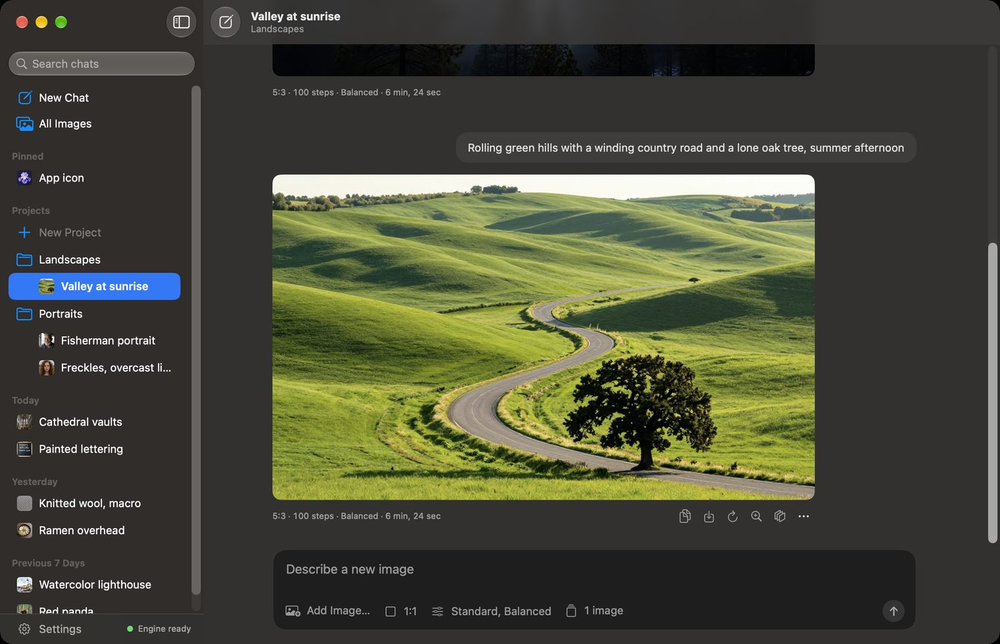</p>

[Iris-3B](https://github.com/speridlabs/iris-3b) is Speridlabs' 3B-parameter
diffusion transformer that generates RGB pixels directly, without a VAE; its
fine-tunes also estimate depth and restore and upscale images. This project is
an independent inference implementation for Apple GPUs. It runs the
**unmodified official weights**, downloaded from Speridlabs' Hugging Face
repository, and adds no training, distillation or quantization.

On a base M5 MacBook Pro with 24 GB, a 1024 × 1024 image takes
**45 s at 10 steps** and **91 s at 20 steps** once the model is loaded, in
about 10 GiB of memory. On the same Mac and the same inputs, the engine runs
1.8–2.0× as fast as the fastest MLX port we measured and 1.5–1.6× as fast as
the upstream PyTorch code with its BF16 recipe, and its images are closer to
the upstream model run in full FP32 than that recipe's (see
[Image quality](#image-quality)).

## Performance

<p align="center">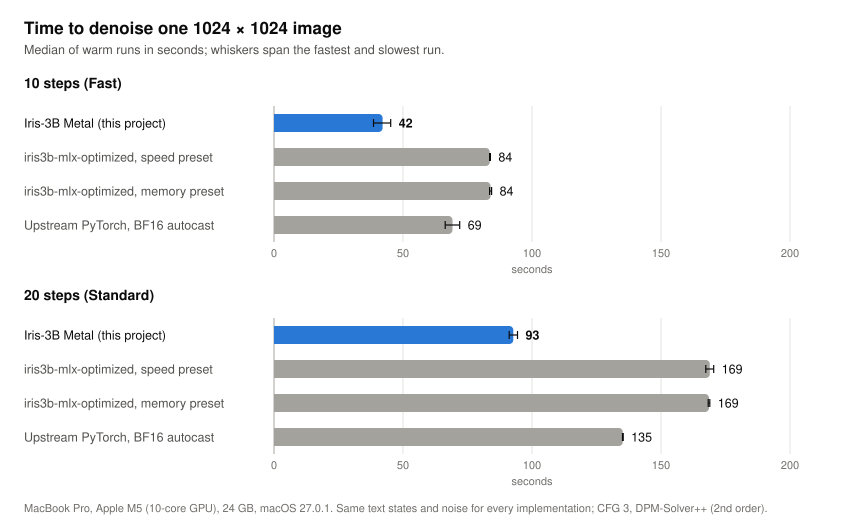</p>

| 1024 × 1024, base M5, 24 GB | 10 steps (Fast) | 20 steps (Standard) | 100 steps |
|---|---:|---:|---:|
| Next image, model loaded | **45 s** | **91 s** | 457 s |
| First image after launch, model load included | 55 s | 100 s | 465 s |
| Peak memory of the process | 10.0 GiB | 10.0 GiB | 10.0 GiB |

Times run from the prompt to the finished image, measured with
`scripts/benchmark.py` in fresh processes: medians of three processes per step
count, and one process at 100 steps. A new prompt adds about 4 s of text
encoding; a repeated one is cached. Each sampling step evaluates the model
twice (classifier-free guidance), about 4.5 s per step. The chart times the
denoising of a saved fixture (text states and noise) by each implementation;
whiskers span the fastest and slowest run.

These numbers were taken with the Claude desktop app, which drove the
measurements, and the window server using about 40% of the GPU's
time; every implementation ran under the same load, interleaved. Runs at the
start of the session, with the GPU nearly idle, took 39 s for 10 steps
(3.9 s per step). The methodology, the raw logs and every comparison are in
[benchmarks/](benchmarks/README.md).

<details>
<summary>Where the time goes, and peak memory compared</summary>
<p align="center">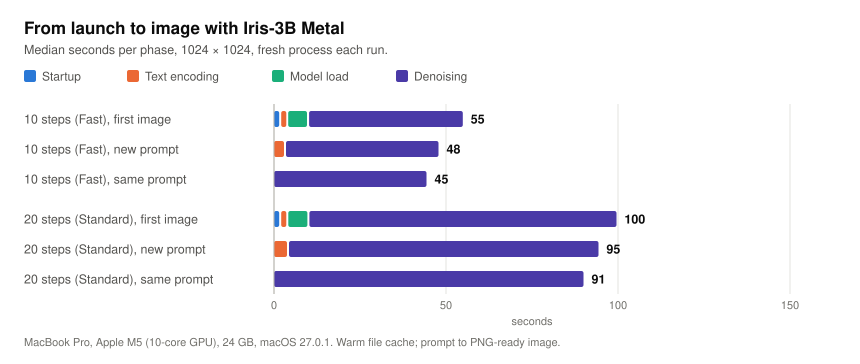</p>
<p align="center">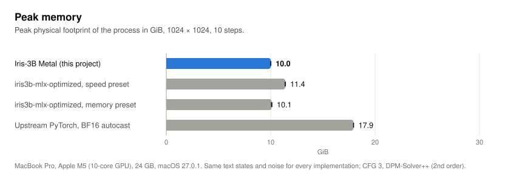</p>
</details>

**Steps.** Iris-3B was evaluated with 100 sampling steps, the default of the
CLI and the API. 10 and 20 steps keep the composition but simplify fine
structure such as hands and small text; they are previews, which is how the
app's Fast and Standard presets present them.

## Examples

<p align="center">
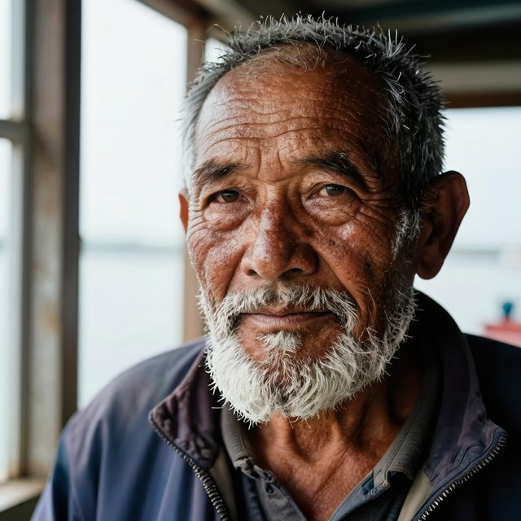
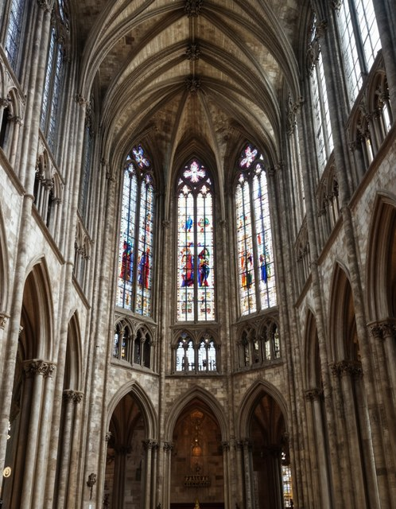
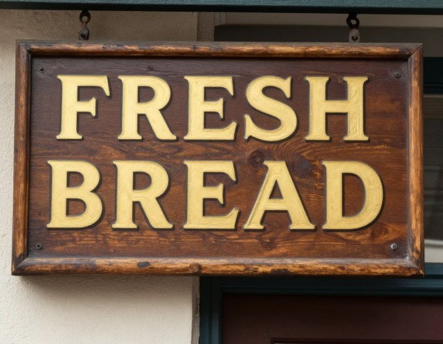
<br>

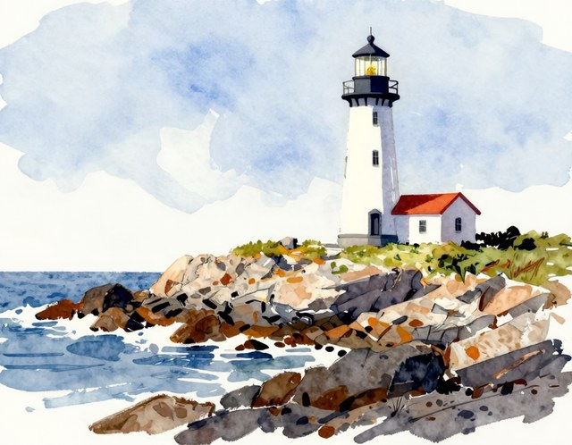
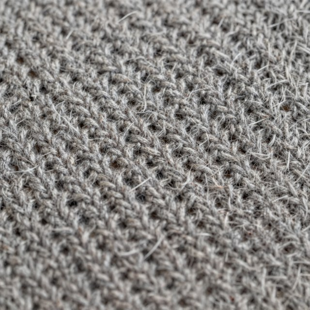
</p>
<p align="center"><sub>Generated by this engine with the defaults (100 steps, guidance 3, seed 0) from the development prompts in <a href="benchmarks/prompts.json"><code>benchmarks/prompts.json</code></a>, at their listed sizes; not curated across seeds.</sub></p>

<p align="center">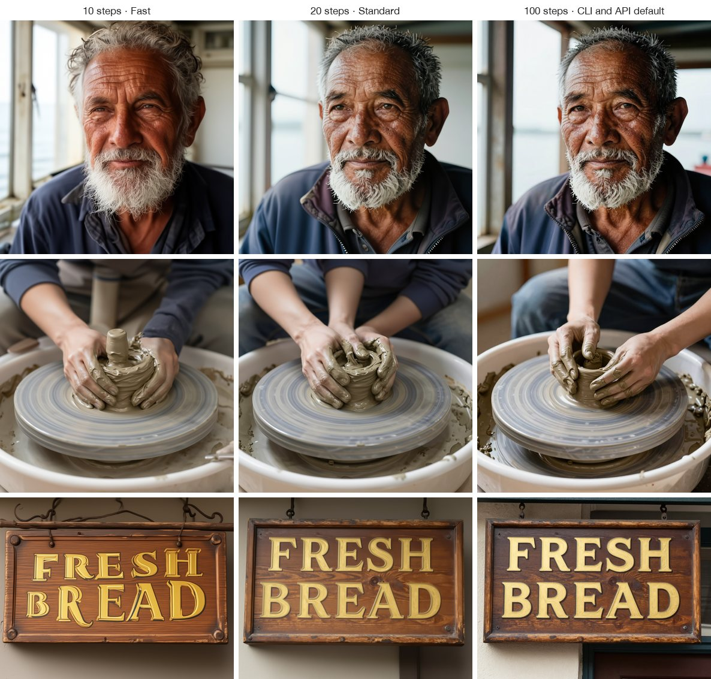</p>
<p align="center"><sub>The same seed at 10, 20 and 100 steps (guidance 3). Fewer steps keep the composition and simplify fine detail.</sub></p>

## Features

- **Text-to-image** at about one megapixel in any aspect ratio from 4:1 to
  1:4 (the model was trained on 21 sizes from 2048 × 512 to 512 × 2048), with
  the upstream sampler (DPM-Solver++, guidance 3). Steps, guidance, seed, size
  and negative prompt are adjustable.
- **Depth estimation** and **4× restoration and upscaling** with the official
  fine-tunes, each downloaded on first use.
- **A native macOS app** (SwiftUI) organized like a chat app: chats, projects,
  pinned chats, an All Images library, batches of up to four images, per-step
  progress and Stop, and a comparison window for depth maps and upscales.
- **`iris-metal`**, a command line for generation, depth and upscaling that
  never overwrites an existing file unless asked.
- **A Python API**, `IrisPipeline`, that keeps the model loaded and caches
  prompt encodings between calls.
- **`iris-metal serve`**, a local HTTP API with a job queue, progress and
  cancellation; the app is a client of it.
- **Local and memory-conscious**: nothing leaves the Mac, the text encoder is
  streamed one layer at a time, and only one model is resident.

Iris-3B does not edit images from instructions, inpaint, or see earlier
messages of a chat; each request is generated on its own.

## Install

**Requirements.** A Mac with Apple Silicon and macOS 15 or later, Python
3.11 or later. Everything here was measured on a MacBook Pro with a base M5 and
24 GB, where text-to-image peaks at about 10 GiB at 1024 × 1024. Macs with
16 GB are untested.

**Disk.** The first generation downloads the Iris-3B checkpoint (12.0 GB) and
the Qwen3-VL-4B-Instruct text encoder weights (8.9 GB) from Hugging Face into
its cache (`~/.cache/huggingface`), at the revisions the engine was validated
against. Depth estimation and upscaling download one more 12.0 GB checkpoint
each, only when first used.

```bash
pipx install "git+https://github.com/TKY-27/iris-3b-metal@v0.3.0"
iris-metal "A red fox sleeping in fresh snow, golden hour" --steps 20 -o fox.png
```

[pipx](https://pipx.pypa.io) installs `iris-metal` into `~/.local/bin`, where
the macOS app finds it. `pip install` into a virtual environment works too.

## Usage

### Command line

```bash
iris-metal "a lighthouse on a rocky coast, watercolor" --size 1152x896 --seed 7
iris-metal "a red panda in a bamboo forest" --steps 10       # a quick preview
iris-metal depth photo.jpg           # depth/photo_depth.png and .npy
iris-metal upscale photo.jpg         # upscaled/photo_x4.png
```

Without `-o`, images are numbered `iris.png`, `iris-2.png`, ... and existing
files are never replaced; depth and upscaling outputs skip names already
taken. Every input and output is checked before a model loads. Each command
has `--help`.

### Python

```python
from iris_metal.cli import resolve_checkpoint
from iris_metal.pipeline import IrisPipeline

pipe = IrisPipeline(resolve_checkpoint("speridlabs/iris-3b", None))  # downloads the validated revision
image = pipe(["a red panda in a bamboo forest"], height=1024, width=1024, steps=20, seed=0)[0]
image.save("panda.png")
```

`IrisPipeline` also takes a local directory with `config.yaml` and
`model.safetensors`, and accepts `cfg_scale`, `negative_prompt` and an
`on_step(step, total)` progress callback.

### HTTP API

`iris-metal serve` runs one resident engine on `127.0.0.1:8765`:

```bash
curl -s localhost:8765/v1/images -d '{"prompt": "a tabby cat on a windowsill", "steps": 20}'   # {"id": "1"}
curl -s localhost:8765/v1/jobs/1                     # status, step, steps, seconds
curl -s localhost:8765/v1/jobs/1/image -o cat.png
curl -s -X DELETE localhost:8765/v1/jobs/1           # cancel
curl -s localhost:8765/v1/depth --data-binary @photo.jpg   # also /v1/upscale
```

`/v1/images` takes `prompt`, `width`, `height`, `steps`, `cfg_scale`, `seed`
and `negative_prompt`. Jobs run in order from a bounded queue (a full queue
answers 429). Cancelling stops a generation at its next step and an upscale
at its next tile. Only one network is resident: switching between
text-to-image, depth and upscaling releases the previous model.
`--checkpoint` and `--weights` take local directories for offline use.

The server has no authentication and must not be exposed beyond localhost.
It refuses requests from web pages (an `Origin` header or a cross-site
`Sec-Fetch-Site`) and for other host names. See [SECURITY.md](SECURITY.md).

### macOS app

The app is a SwiftUI client of `iris-metal serve` and holds no model code.
It is not distributed as a signed binary; build it with Xcode 27:

```bash
cd apps/macos
xcodebuild -scheme Iris -configuration Release -derivedDataPath build build
open build/Build/Products/Release/Iris.app
```

The app uses a server already running on its port, or starts `iris-metal
serve` itself from `~/.local/bin`, `/opt/homebrew/bin` or `/usr/local/bin`;
for a virtual environment, set the path to its `bin/iris-metal` in Settings.

- **Chats.** Type a prompt, or add or drop an image to restore and upscale it
  or estimate its depth. Results open in Quick Look and can be copied, saved,
  varied with a new seed, reused as settings, or passed on to upscaling and
  depth. A depth map or upscale opens next to its original in a comparison
  window.
- **Settings stay out of the way.** The composer shows the shape and two
  words for quality and prompt adherence; a popover holds the presets, the
  exact steps and guidance, the seed and the negative prompt. Quality presets
  are Draft, Fast, Standard, High and Maximum: 4, 10, 20, 30 and 50 steps;
  the app starts at Standard. Type 100 in the exact field for the model's
  evaluated setting.
- **Progress.** The image's frame shows `65% · 13 / 20 steps` with the time
  left; an upscale counts its tiles. Stop is where Send was. Batches of up to
  four images run one after another.
- **Library.** Chats, projects, pins and images live in
  `~/Library/Application Support/Iris` (`Library.json` and the images). A
  `History` folder from Iris 0.1 is imported once into a chat named
  “Earlier images”.
- **Restoration comes with upscaling.** The upscaler repairs blur, noise and
  compression while it enlarges four times; inputs above 512 pixels on the
  short side or 1024 on the long side are reduced first, so a 1024 × 1024
  image becomes 2048 × 2048. Same-size restoration is not offered: tested at
  1×, the model redraws fine structure.

The app's icon, an iris flower, was drawn by Iris-3B itself at 100 steps
(`apps/macos/icon`).

## How it works

Iris-3B is a 24-block transformer over 16 × 16 pixel patches (8 dual-stream
blocks, then 16 single-stream blocks; grouped-query attention, gated attention,
sandwich RMSNorm) followed by four pixel-transformer blocks that decode every
patch back to pixels, conditioned on twelve hidden layers of Qwen3-VL-4B. A
1024 × 1024 image at 100 steps is about 4.6 PFLOP. `src/iris_metal` evaluates
the upstream modules' weights with its own forward pass:

- **Matrix multiplies and attention stay in PyTorch's MPS kernels.** At the
  trunk's shapes they run at 13.7–15.5 TFLOPS in FP16 or BF16 on the M5,
  84–95% of what a compute-only Metal 4 `matmul2d` kernel reached on the same
  GPU. Custom GEMMs, epilogue fusion and packing the Q/K/V/gate and SwiGLU
  projections into wider GEMMs were measured and rejected (no gain beyond
  thermal drift). Attention uses PyTorch's fused, memory-efficient SDPA.
- **Everything between the matrix multiplies is fused into custom Metal
  kernels**: query/key RMSNorm + RoPE + head layout; each branch's input norm
  and adaLN modulation; the sandwich post-norm, gate and residual add, in
  place on an FP32 residual stream; and the per-pixel half of every pixel
  block.
- **Precision is chosen per part.** The transformer trunk's linear layers and
  attention take FP16 inputs, which carry three more mantissa bits than BF16;
  BF16 hurts most in the late single-stream blocks, whose QK-norm gains reach
  27 and amplify the rounding of queries and keys. Norms, adaLN modulation and
  the residual stream stay FP32. The pixel stage and the text adapter keep
  BF16: the pixel stream reaches about 1.4 × 10⁴, and neither is sensitive to
  BF16 rounding. The largest FP16 trunk value over the benchmark prompts is
  2520, and every result is checked for overflow.
- **The text encoder is streamed.** Qwen3-VL-4B runs one decoder layer at a
  time from its checkpoint files, for the real prompt tokens only, so it peaks
  at about 1.5 GiB instead of loading 8 GB; the next layer's transfer overlaps
  the current one's compute.
- **Work that does not change is done once.** The diffusion model stays
  resident between requests; prompt encodings and the adapted conditioning of
  recent prompts (the empty negative prompt included) are cached; the shared
  adaLN projections are computed once per step.

In a single-stream block at 1024 × 1024, 66% of the GPU time is matrix
multiplies, 22% attention and 12% everything else.

## Image quality

The engine is checked three ways: unit tests against the upstream PyTorch
model on a randomly initialized copy of the architecture; per-step velocity
error against an FP32 forward of the real checkpoint; and complete 100-step
generations of a 12-prompt development set and a separate 12-prompt held-out
set (portraits, hands, full bodies, textures, architecture, typography, small
objects, repetitive structure, animals, illustration, food) at native aspect
ratios. `scripts/evaluate.py`, `scripts/compare_runs.py` and
`scripts/precision_study.py` reproduce them.

**Against the upstream model in FP32.** Prompt encodings and initial noise
are saved, so every implementation denoises exactly the same inputs with the
same sampler. Over eight prompts at 512 × 512 and 100 steps (six development,
two held-out):

| Against upstream FP32 | Mean NRMSE | Median NRMSE | Mean LPIPS |
|---|---:|---:|---:|
| Upstream code, BF16 autocast (its inference recipe) | 25.4% | 21.7% | 0.162 |
| **This engine** | **8.8%** | **5.7%** | **0.025** |
| This engine with BF16 instead of FP16 trunk weights | 9.2% | 7.7% | 0.030 |

NRMSE measures numerical distance from FP32 and LPIPS perceptual distance; a
diffusion trajectory amplifies small differences, so single images vary
widely (lettering diverges most, portraits least). Per sampling step, the
engine's velocity differs from an FP32 forward by 0.85–1.4% (relative L2 at
three noise levels), against 8–15% for the BF16 autocast recipe; FP32
attention would lower that to 0.65–1.1% at 1.65× the time.

<p align="center">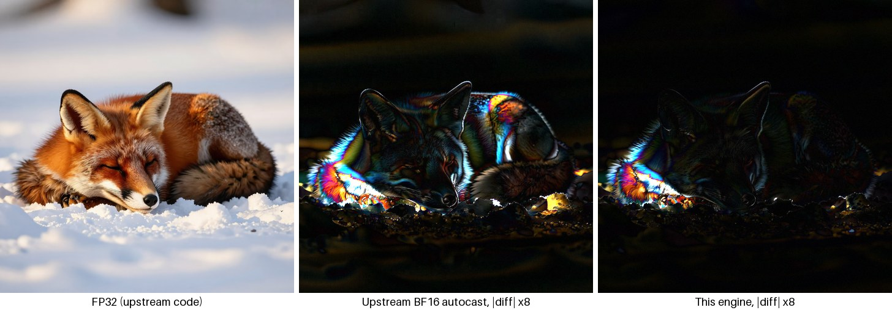</p>
<p align="center"><sub>1024 × 1024, 100 steps. Mean absolute difference from FP32: 3.2/255 for the upstream BF16 recipe, 1.4/255 for this engine.</sub></p>

**Depth and restoration.** On the upstream demo inputs and two generated
images, the engine's depth maps differ from the upstream code in FP32 by
0.2–0.5% (relative L2; the BF16 recipe 0.8–2.8%) and its 4× restorations
match it at 54 dB PSNR (the BF16 recipe 47–51 dB). `scripts/restore_study.py`
shows why restoration is only offered with upscaling: one pass at 1× improved
LPIPS only for strong blur and made JPEG and softened images worse, redrawing
thin structure.

**Patch seams.** Iris-3B predicts pixels in 16 × 16 patches. At 768 × 768 and
1024 × 1024 the outputs show no visible seams at 3× magnification; an
image-space deblocking filter was tried and rejected because it suppressed
real detail.

## Limitations

- Apple Silicon GPUs only; the engine has no CPU or CUDA path (the upstream
  code in `src/iris3b` still trains and runs on CUDA). Tested on one Mac.
- 100 steps take about 7.6 minutes per 1024 × 1024 image; 10 and 20
  steps change fine structure.
- Keep images near one megapixel. Well below that, for example at
  512 × 512, the model's output shows its 16-pixel patch grid, in the upstream
  FP32 code as well. 2048 × 512 and 512 × 2048 were only smoke-tested.
- Batches larger than one image per call are supported by the Python API but
  untested at 1024 × 1024 on 24 GB; the app and the server generate one image
  at a time.
- What the images get wrong is the model's: on the held-out prompt of hands on
  a piano, the upstream FP32 code draws extra hands just as the engine does.
- The macOS app is built from source; there is no signed or notarized
  binary.

## Development

```bash
pip install -e ".[dev]"            # ".[train,dev]" for the upstream training tests
pytest                             # tiny random models; no checkpoint or network needed
python apps/macos/fake_engine.py   # the HTTP API over CPU stand-ins, for app work
```

See [CONTRIBUTING.md](CONTRIBUTING.md) for the checks CI runs, how to work on
the app without a GPU, and what evidence engine changes need. The upstream
training code is retained under `src/iris3b/`; `UPSTREAM_README.md` is
upstream's README as it was (read `pip install -e .` there as
`pip install -e ".[train]"`). Only load trusted training `.pth` files: the
upstream resume, sampling and export commands use pickle; the Metal engine
loads safetensors only.

## License and credits

Apache License 2.0, as is upstream. **Iris-3B, its research, training code and
weights are by [Speridlabs](https://speridlabs.com)** (Hanqiu Li Cai and Chema
Garabito): [paper](https://arxiv.org/abs/2610.09450),
[code](https://github.com/speridlabs/iris-3b),
[weights](https://huggingface.co/speridlabs/iris-3b). This is an independent
project, not an official Speridlabs release. The text encoder,
[Qwen3-VL-4B-Instruct](https://huggingface.co/Qwen/Qwen3-VL-4B-Instruct)
(Alibaba Cloud, Apache 2.0), is downloaded at runtime. No weights are included
in this repository or its releases. [NOTICE](NOTICE) lists what this
distribution adds and changes.

If you use Iris-3B, cite the paper:

```bibtex
@article{licai2026iris,
  title   = {Iris-3B: Going Beyond the Latent with Pixel-Space
             Diffusion Training, Conversion and Fine-Tuning},
  author  = {Li Cai, Hanqiu and Garabito, Chema},
  journal = {arXiv preprint arXiv:2610.09450},
  year    = {2026},
  url     = {https://arxiv.org/abs/2610.09450}
}
```
