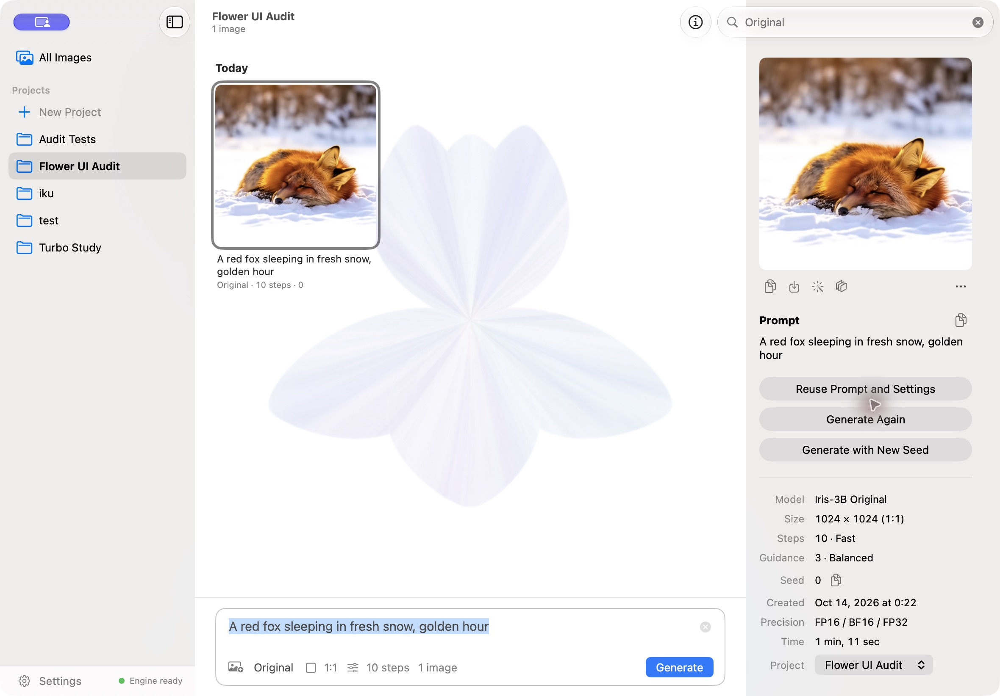

<p align="center"></p>

<h1 align="center">Iris-3B Metal</h1>

<p align="center">
<strong>Direct RGB pixel-space diffusion on Apple Silicon.</strong><br>
An independent MPS and Metal inference engine, with a native macOS app, CLI, Python API and local HTTP API.
</p>

<p align="center">
<a href="https://github.com/TKY-27/iris-3b-metal/releases/latest"></a>
<a href="LICENSE"></a>
<a href="https://github.com/TKY-27/iris-3b-metal/actions/workflows/ci.yml"></a>
</p>

<p align="center"></p>
<p align="center"><sub>A real macOS app capture with an image generated by Iris-3B.</sub></p>

## Why pixel space

[Iris-3B](https://github.com/speridlabs/iris-3b) is Speridlabs' 3B-parameter
pixel-space diffusion transformer. Its text-to-image path denoises RGB pixel
values directly and predicts their flow in pixel space; it uses no lossy VAE
latent representation or VAE encode/decode stage. This avoids the VAE
representation used by VAE-based latent diffusion, but it does not make
inference automatically faster or every image better. The pixel-space
transformer has substantial compute costs of its own.

| Upstream Iris-3B | Iris-3B Metal |
| --- | --- |
| Original model architecture, training code, weights, and depth and restoration fine-tunes by Speridlabs. | Independent Apple Silicon inference work: PyTorch MPS, custom Metal kernels, precision and memory optimizations, and streamed Qwen text encoding. Includes a macOS app, CLI, Python API and local HTTP API. |

The upstream depth and restoration fine-tunes reuse the Iris architecture for relative-depth estimation and image restoration. The model, original training and weights are upstream work; this repository does not claim them as its invention. The engine runs the official weights without fine-tuning or distillation.

## At a glance

<p align="center"></p>

On the base M5 MacBook Pro with 24 GB, 1024 × 1024, CFG 3, a warm repeated prompt takes about **45 s at 10 steps** or **91 s at 20 steps**. Peak process physical memory is about **10.0 GiB**. Macs with 16 GB have not been tested; this measurement does not establish comfortable operation on them.

## Examples and tasks

### Text to image

<p align="center">


<br>


</p>
<p align="center"><sub>Generated by this engine at 100 steps, guidance 3 and seed 0, from the development prompts in <a href="benchmarks/prompts.json"><code>benchmarks/prompts.json</code></a>.</sub></p>

<p align="center"></p>
<p align="center"><sub>Fewer steps can preserve composition, but fine structure changes; 10 and 20 steps are not equivalent in detail to the model's 100-step setting.</sub></p>

### Restoration and depth

<table>
<thead><tr><th>Image restoration and 4× upscaling</th><th>Relative depth estimation</th></tr></thead>
<tbody><tr>
<td><br><sub>Before · Restored result</sub></td>
<td><br><sub>Photo · Depth map; near is brighter</sub></td>
</tr></tbody>
</table>

These are upstream Iris fine-tunes run through this engine. Depth is relative, not measured in metres. Restoration enlarges 4× and can redraw fine structure; compare the result with the input.

## Quick start

**Requirements:** Apple Silicon, macOS 15 or later, and Python 3.11 or later.
First use downloads only the selected text-to-image checkpoint: Original
(12.0 GB) or official Turbo (6.0 GB BF16), plus the shared 8.9 GB
Qwen3-VL-4B-Instruct text encoder from Hugging Face. Depth and restoration
weights (about 12 GB each) download only when first used. Model weights are not
included in the repository or release.

```bash
pipx install "git+https://github.com/TKY-27/iris-3b-metal@v0.4.0"
iris-metal "A red fox sleeping in fresh snow, golden hour" --steps 20 -o fox.png
```

`v0.4.0` is the current repository and macOS app release tag; the Python
engine in that source reports version `0.3.0`. [pipx](https://pipx.pypa.io)
installs `iris-metal` in `~/.local/bin`, where the app can find it. Installing
the package does not download model weights; the first inference does. A
virtual environment with `pip install` also works.

**Explore:** [Usage](#usage) · [macOS app](#macos-app) · [Performance details](#performance-details) · [How it works](#how-it-works) · [Image quality](#image-quality) · [Development](#development) · [License and credits](#license-and-credits)

Turbo and the gallery described below are unreleased changes. To use them, install
this checkout with `pip install -e .` and build the app from the same checkout;
the published `v0.4.0` tag does not include them.

## What it supports

- Original text-to-image at about one megapixel, with aspect ratios from 4:1 to 1:4
  (the model was trained on 21 sizes from 2048 × 512 to 512 × 2048). The
  upstream sampler is DPM-Solver++ (2nd order); steps, guidance, seed, size
  and negative prompt can be set.
- **Official Iris-3B Turbo:** the full-parameter distilled checkpoint, four fixed
  deterministic flow-Euler steps with sigmas `1, 0.938, 0.833, 0.625`. Guidance
  is baked into the weights; steps, CFG and negative prompts cannot be adjusted.
  This is a separate model with different image characteristics from Original.
- Relative depth estimation and 4× image restoration/upscaling with the official upstream fine-tunes.
- A native SwiftUI macOS app, `iris-metal` CLI, `IrisPipeline` Python API, and localhost HTTP API.
- Local inference on Apple Silicon. Prompts and images are processed on the Mac; first use downloads model files from Hugging Face. The app's release checker contacts GitHub when enabled.

Iris-3B does not edit images from instructions, inpaint, or use earlier prompts or images. Each text-to-image request starts independently.

## Usage

### Command line

```bash
iris-metal "a lighthouse on a rocky coast, watercolor" --size 1152x896 --seed 7
iris-metal "a red panda in a bamboo forest" --steps 10
iris-metal "a red panda in a bamboo forest" --model turbo --seed 7
iris-metal depth photo.jpg           # depth/photo_depth.png and .npy
iris-metal upscale photo.jpg         # upscaled/photo_x4.png
```

The CLI and Python API default to Original and its 100 steps. Turbo always uses four steps. Without `-o`, the CLI
numbers outputs `iris.png`, `iris-2.png`, and so on without replacing existing
files. Depth and upscale skip names already taken. Inputs and outputs are
checked before a model loads; each command has `--help`.

### Python

```python
from iris_metal.cli import resolve_checkpoint
from iris_metal.pipeline import IrisPipeline

pipe = IrisPipeline(resolve_checkpoint("speridlabs/iris-3b", None))  # resolves the validated revision
image = pipe(["a red panda in a bamboo forest"], height=1024, width=1024, steps=20, seed=0)[0]
image.save("panda.png")
```

`IrisPipeline` also accepts a local directory containing `config.yaml` and
`model.safetensors`, and supports `cfg_scale`, `negative_prompt` and an
`on_step(step, total)` progress callback. It keeps the model loaded and caches
recent prompt encodings between calls. For Turbo, pass
`resolve_checkpoint("speridlabs/iris-3b", None, model="turbo")` and omit the three
unsupported controls. To keep reproduction metadata when saving through PIL,
use `image.save("panda.png", pnginfo=iris_metal.turbo.png_info(image))` after
importing `iris_metal.turbo`; the CLI and HTTP server do this automatically.

### HTTP API

`iris-metal serve` runs one resident engine on `127.0.0.1:8765`:

```bash
curl -s localhost:8765/v1/images -H 'Content-Type: application/json' -d '{"prompt":"a tabby cat on a windowsill","steps":20}'  # {"id":"1"}
curl -s localhost:8765/v1/jobs/1                 # repeat until status is "done"
curl -s localhost:8765/v1/jobs/1/image -o cat.png
curl -s -X DELETE localhost:8765/v1/jobs/1       # cancel
curl -s localhost:8765/v1/depth --data-binary @photo.jpg  # also /v1/upscale
```

`/v1/images` accepts `model` (`original` by default, or `turbo`), `prompt`,
`width`, `height`, `steps`, `cfg_scale`, `seed` and `negative_prompt`. For Turbo,
send e.g. `{"model":"turbo","prompt":"a red fox","seed":0}`; omit `steps`,
`cfg_scale` and `negative_prompt` or the server returns 400. `/v1/health` advertises
`supported_models` and `loaded_model`. Completed jobs return reproduction
metadata, also embedded as JSON in the PNG `iris` text field. Jobs run in order in a bounded queue; a full queue
returns 429. Cancellation stops generation at the next step and upscaling at
the next tile. Switching between text-to-image, depth and restoration releases
the previous model, including when switching Original and Turbo.
`--checkpoint`, `--turbo-checkpoint` and `--weights` accept separate local
directories for offline use. Checkpoints download on first use, and Original
remains available after using Turbo.

The server has no authentication and must not be exposed beyond localhost. It rejects browser-origin requests and other host names. See [SECURITY.md](SECURITY.md).

## macOS app

The SwiftUI app is a client of `iris-metal serve`; it contains no model code.
The current app release is [v0.4.0](https://github.com/TKY-27/iris-3b-metal/releases/tag/v0.4.0),
while the Python engine is separately versioned at `0.3.0`. The release is
source-only: no signed, downloadable app or model weights are available. Build
the app from source with Xcode 27:

```bash
cd apps/macos
xcodebuild -project Iris.xcodeproj -scheme Iris -configuration Release -derivedDataPath build CODE_SIGNING_ALLOWED=NO build
open build/Build/Products/Release/Iris.app
```

The app uses an engine already running on its port, or starts `iris-metal serve` from `~/.local/bin`, `/opt/homebrew/bin` or `/usr/local/bin`. For a virtual environment, set the path to its `bin/iris-metal` in Settings.

The app can check GitHub for compatible stable releases and open their release pages. It does not download or install app updates. Automatic checks can be disabled in Settings. Iris does not upgrade or modify a Python environment; Settings reports engine compatibility and manual update instructions. See [macOS releases and updates](docs/macos-updates.md).

- **Gallery.** Every result appears in a gallery by day, newest first, with its model, prompt, seed and steps; projects keep their own images, and search finds images by prompt, model or seed. The prompt bar below the gallery generates batches of up to four images, and the prompt stays for the next request. The details panel shows the full prompt and settings, and can copy the seed, reuse the prompt and settings, or generate again with the same seed or a new seed. Results can be saved, copied, moved to a project, upscaled or turned into depth maps, and depth maps and restored images can be compared with their inputs.
- **Motion.** The background and active generation tile retain the pointer-reactive liquid field, shaped as an iris flower. Animation can be turned off in Settings and respects macOS Reduce Motion. The background stops drawing after the pointer settles, while the active generation tile keeps moving; hidden windows stop animation.
- **Generation controls.** The model menu selects Original or Turbo. Turbo only exposes shape and seed; its four steps are fixed. Original tuning is preserved when switching models. Original presets are Draft, Fast, Standard, High and Maximum at 4, 10, 20, 30 and 50 steps; Standard is the default. The exact controls include steps, guidance, seed and negative prompt. The model's evaluated 100-step setting is available by entering 100.
- **Progress and library.** Generation reports step progress and can be stopped. Upscaling reports tiles. Images with their prompts and settings, and projects, live under `~/Library/Application Support/Iris`. A legacy `History` folder from Iris 0.1 is imported once; existing chat entries remain visible. Saving upgrades the library to format 2 so older apps cannot silently discard Turbo model identity. Older apps refuse to modify this newer library.
- **Restoration limits.** The restorer works at 4×. Inputs above 512 pixels on
  the short side or 1024 on the long side are reduced first, so a 1024 × 1024
  input produces a 2048 × 2048 result. Same-size restoration is not offered:
  at 1× the model can redraw fine structure.

The app icon was generated by Iris-3B at 100 steps; its source is in [`apps/macos/icon`](apps/macos/icon).

## Performance details

### Official Turbo (unreleased)

In the October 13 validation on an M5 24 GiB, 1024 × 1024 Turbo generation took **12.6–22.2 s
warm** and 19.6–29.2 s for the first request in two runs. The first run peaked
at 10.0 GiB including text encoding. These observed ranges include session
variation, not a controlled median. Turbo is a different checkpoint from
Original. Three native-size saved-input fixtures matched the official Turbo
MPS recipe bitwise; BF16 Linear storage reduced the paired denoising process
peak from 14.8 to 8.9 GiB. See [Turbo validation and reproduction](benchmarks/turbo-validation-2026-10-13.md)
for pins, comparisons, rejected experiments and limitations.

The [October 14 optimization measurements](benchmarks/performance-2026-10-14.md)
used alternating baseline/candidate runs on the same busy machine. Exact
conditioning reuse reduced warm Turbo generation from 22.40 to 21.83 seconds
on average (2.5%, six requests each), with bitwise-equal images. Keeping Turbo's
CPU prompt cache reduced return-to-Turbo preparation from about 6.64 to 3.45
seconds; weights are still unloaded when switching models. No additional
Original speedup is claimed. A lower-load follow-up confirmed 12.695 to 12.414
seconds (2.2%, four requests each), again with identical pixels.

### Original prompt-to-image (earlier baseline)

Measurements used a base M5 MacBook Pro with 24 GB, 1024 × 1024, guidance 3, FP16 trunk and attention, and warm file cache. The warm repeated-prompt values below are from `scripts/benchmark.py`; each 10- and 20-step value is the median of three fresh processes. The 100-step run was one process.

| Prompt to PNG-ready image | 10 steps | 20 steps | 100 steps |
|---|---:|---:|---:|
| First image after launch, including model load | 55.5 s | 100.2 s | 464.9 s |
| Warm, same prompt cached, model loaded | **44.9 s** | **90.5 s** | **457.5 s** |
| Warm, new prompt | 48.4 s | 94.9 s | 463.4 s |
| Peak process physical memory | 10.0 GiB | 10.0 GiB | 10.0 GiB |

Text encoding adds about 2 seconds for a new prompt (about 4 seconds including the tokenizer/text-encoder setup on first use); a repeated prompt is cached. Each sampling step evaluates the model twice for classifier-free guidance. The app and its progress callbacks add some system load, so results vary with background GPU work.

### Same-input denoising comparison

<p align="center"></p>

The figure and table use a saved fixture (text states and noise) with the same inputs for every implementation. These are **denoising-only** times: model load and text encoding are excluded. They are a different measurement scope from the prompt-to-image timings above.

| 1024 × 1024, warm fixture | 10 steps | 20 steps | Peak process memory (10-step fixture) |
|---|---:|---:|---:|
| **Iris-3B Metal** | **42.1 s** | **92.8 s** | **10.0 GiB** |
| [iris3b-mlx-optimized](https://github.com/octaviusp/iris3b-mlx-optimized), speed preset | 83.6 s | 168.9 s | 11.4 GiB |
| iris3b-mlx-optimized, memory preset | 84.0 s | 168.6 s | 10.1 GiB |
| Upstream PyTorch, BF16 autocast recipe | 69.2 s | 135.2 s | 17.9 GiB |

The comparison used two interleaved rounds where available, with the second round in reverse order. The MLX and BF16 runs are different inference implementations and precision recipes; these results do not establish a universal speed or image-quality ranking. The upstream Mac FP32 path was not part of this comparison: one separate 10-step measurement took 346 s and a 100-step measurement took 2940 s, with roughly 20 GiB use and heavy swapping on the 24 GB Mac. Those single runs are not a controlled speedup baseline.

For the full machine details, raw logs, commands and reproduction steps, see [benchmark methodology and records](benchmarks/README.md).

**Step count matters.** The upstream model was evaluated at 100 steps. Ten and twenty steps can preserve composition while changing fine structure, including hands and small text; the app's Fast and Standard presets are previews, not claims of equivalent detail.

## How it works

Upstream Iris-3B uses a 24-block transformer over 16 × 16 pixel patches (8 dual-stream blocks, then 16 single-stream blocks; grouped-query attention, gated attention and sandwich RMSNorm), followed by four pixel-transformer blocks that predict pixels within patches, conditioned on twelve hidden layers of Qwen3-VL-4B. A 1024 × 1024 image at 100 steps is about 4.6 PFLOP. For Original, `src/iris_metal` evaluates the upstream weights with an independent forward pass:

- **Matrix multiplies and attention use PyTorch MPS kernels.** At the trunk's shapes they run at 13.7–15.5 TFLOPS in FP16 or BF16 on the M5, 84–95% of a compute-only Metal 4 `matmul2d` kernel measured on the same GPU. Custom GEMMs, epilogue fusion and wider packed projections were measured and rejected because they showed no gain beyond thermal drift. Attention uses PyTorch's fused, memory-efficient SDPA.
- **Custom Metal kernels fuse work around the matrix multiplies:** query/key RMSNorm, RoPE and head layout; input normalization and adaLN modulation; sandwich post-norm, gating and residual add on an FP32 residual stream; and the per-pixel half of each pixel block.
- **Precision is chosen per part.** The trunk's linear layers and attention take FP16 inputs, which have three more mantissa bits than BF16. Late single-stream QK-norm gains reach 27 and amplify query/key rounding. Norms, adaLN modulation and the residual stream stay FP32. The pixel stage and text adapter use BF16; the pixel stream reaches about 1.4 × 10⁴. The largest measured FP16 trunk value was 2520, and every result is checked for overflow.
- **Qwen text encoding is streamed.** One decoder layer is loaded at a time from checkpoint files for real prompt tokens, keeping the encoder process footprint near 1.5 GiB instead of loading the full 8 GB model at once. The next layer's transfer overlaps the current layer's compute.
- **Repeated work is cached.** The diffusion model stays resident between requests; recent prompt encodings and adapted conditioning (including the empty negative prompt) are cached; shared adaLN projections are computed once per step.

In a single-stream block at 1024 × 1024, measured GPU time was 66% matrix multiplies, 22% attention and 12% other work.

Turbo keeps the official `IrisDiT` forward and BF16 autocast with deterministic
flow-Euler sampling. Linear parameters remain in their checkpoint BF16 format;
other parameters and the flow state stay FP32. This removes redundant FP32
linear-weight storage while preserving the reference arithmetic. Identical text
conditioning is reused within each request and shared modulation within each step.
Original's fused Metal forward was tested for Turbo and rejected for excessive
numerical drift. Turbo performs four single-batch forwards without a negative
conditioning branch. Both models use the streamed text encoder and bounded
prompt cache.

## Image quality

The Original engine is checked against the upstream PyTorch implementation on a randomly initialized copy of the architecture, by per-step velocity error against an FP32 forward of the real checkpoint, and with complete 100-step generations on a 12-prompt development set and separate 12-prompt held-out set. The prompts cover portraits, hands, full bodies, textures, architecture, typography, small objects, repetitive structure, animals, illustration and food. `scripts/evaluate.py`, `scripts/compare_runs.py` and `scripts/precision_study.py` reproduce these studies.

**Against upstream FP32.** Prompt encodings and initial noise are saved so each implementation uses the same inputs and sampler. Across eight 512 × 512 prompts at 100 steps (six development and two held-out):

| Against upstream FP32 | Mean NRMSE | Median NRMSE | Mean LPIPS |
|---|---:|---:|---:|
| Upstream code, BF16 autocast (its CUDA inference recipe) | 25.4% | 21.7% | 0.162 |
| **This engine** | **8.8%** | **5.7%** | **0.025** |
| This engine with BF16 instead of FP16 trunk weights | 9.2% | 7.7% | 0.030 |

NRMSE is numerical distance from FP32; LPIPS is perceptual distance. A diffusion trajectory amplifies differences, and individual outputs vary by prompt. Per-step velocity error is 0.85–1.4% relative L2 for this engine versus 8–15% for the BF16 autocast recipe at three noise levels; FP32 attention reduces the engine's error to 0.65–1.1% at 1.65× the time.

<p align="center"></p>
<p align="center"><sub>1024 × 1024, 100 steps. Mean absolute pixel difference from FP32: 3.2/255 for upstream BF16, 1.4/255 for this engine.</sub></p>

**Depth and restoration.** On upstream demo inputs and two generated images, depth maps differ from upstream FP32 by 0.2–0.5% relative L2 (BF16 recipe: 0.8–2.8%). Four-times restoration matches upstream at 54 dB PSNR (BF16 recipe: 47–51 dB). `scripts/restore_study.py` found that applying the restorer at 1× can redraw thin structure and worsen some softened or JPEG inputs, so the app offers restoration with upscaling.

**Patch boundaries.** Iris-3B predicts pixels in 16 × 16 patches. At 768 × 768 and 1024 × 1024, the tested outputs showed no visible patch seams at 3× magnification. A deblocking filter was rejected because it suppressed real detail.

## Limitations

- The inference engine requires an Apple Silicon GPU; it has no CPU or CUDA path. The retained upstream training code supports CUDA. Performance and quality measurements are from one Mac.
- Ten- and twenty-step previews change fine detail. One hundred steps takes about 7.6 minutes per 1024 × 1024 image in the warm benchmark.
- Keep text-to-image sizes near one megapixel. At 512 × 512, the model can show its 16-pixel patch grid, as can upstream FP32; 2048 × 512 and 512 × 2048 were smoke-tested only.
- Python batches larger than one image are supported but untested at 1024 × 1024 on 24 GB. The app and server process one image at a time.
- Model errors are inherited: on a held-out prompt of hands on a piano, upstream FP32 also drew extra hands.
- The app is source-buildable; there is no signed or notarized downloadable application.
- The engine does not call a remote inference or moderation service. Local execution does not guarantee what the underlying model can generate.

## Development

```bash
pip install -e ".[dev]"
pytest tests/test_metal_*.py tests/test_compare_runs.py
```

For the complete Python suite, install the upstream training dependencies:

```bash
pip install -e ".[train,dev]"
pytest
```

The Codex Run action (`script/build_and_run.sh`) builds an isolated development
app and library under `.scratch/macos-development`. It does not use the user
library. Set `IRIS_DEV_ROOT` to choose a different development directory.

For macOS app work without a GPU or model download, start the fake HTTP engine:

```bash
python apps/macos/fake_engine.py
```

See [CONTRIBUTING.md](CONTRIBUTING.md) for CI checks, app work without a GPU and evidence for engine changes. The upstream training code is retained under `src/iris3b/`; `UPSTREAM_README.md` is preserved from upstream (read `pip install -e .` there as `pip install -e ".[train]"`). Only load trusted training `.pth` files: upstream resume, sampling and export commands use pickle; the Metal inference engine loads safetensors.

## License and credits

Apache License 2.0, as is upstream. **Iris-3B, its research, training code, weights and upstream fine-tunes are by [Speridlabs](https://speridlabs.com)** (Hanqiu Li Cai and Chema Garabito): [paper](https://arxiv.org/abs/2610.09450), [code](https://github.com/speridlabs/iris-3b), [weights](https://huggingface.co/speridlabs/iris-3b). This is an independent project, not an official Speridlabs release. The text encoder, [Qwen3-VL-4B-Instruct](https://huggingface.co/Qwen/Qwen3-VL-4B-Instruct) (Alibaba Cloud, Apache 2.0), downloads at runtime. No weights are included in this repository or its releases. [NOTICE](NOTICE) records upstream attribution and the files this distribution adds or modifies.

If you use Iris-3B, cite its paper:

```bibtex
@article{licai2026iris,
  title   = {Iris-3B: Going Beyond the Latent with Pixel-Space
             Diffusion Training, Conversion and Fine-Tuning},
  author  = {Li Cai, Hanqiu and Garabito, Chema},
  journal = {arXiv preprint arXiv:2610.09450},
  year    = {2026},
  url     = {https://arxiv.org/abs/2610.09450}
}
```
