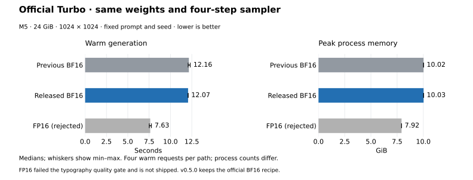

# v0.5.0 release measurements — 2026-10-14

v0.5.0 ships the official BF16 Turbo recipe. The faster FP16 candidate
failed the independent quality gate and is shown only as an unshipped
comparison. These final release measurements are separate from the earlier
[FP16 study](turbo-metal-2026-10-14.md) and the
[October 11 Original baseline](README.md). Measurements use one M5 MacBook
Pro with 24 GiB unified memory, macOS 27.0.1, Python 3.14.8, PyTorch 2.14.1
and Transformers 5.19.0, on AC power with Low Power Mode disabled.

## Timing and memory

| Model / path | Model load | First request | Warm request (min–max) | Peak process memory |
|---|---:|---:|---:|---:|
| Original · 10 steps | 6.95 s | 48.96 s | **38.38 s** (37.98–39.19) | 10.03 GiB |
| Original · 20 steps | 6.54 s | 86.86 s | **76.04 s** (75.30–76.54) | 10.02 GiB |
| Turbo · previous BF16 · 4 steps | 2.71 s | 18.63 s | **12.16 s** (12.07–12.32) | 10.02 GiB |
| Official Turbo · released BF16 · 4 steps | 2.80 s | 18.66 s | **12.07 s** (12.06–12.08) | 10.03 GiB |
| Rejected Turbo candidate · Metal FP16 · 4 steps | 2.62 s | 13.94 s | **7.63 s** (7.52–7.78) | 7.92 GiB |

Values are medians. Each warm value includes four requests. Original and released Turbo load/first/peak values use two processes each; the earlier BF16/FP16 comparison uses four per path. See the method below for the exact timing boundaries.



In the candidate comparison, rejected Metal Turbo reduced median warm time by **37.3%** (12.16 → 7.63 s) and peak process memory by **20.9%** (10.02 → 7.92 GiB). All four Metal warm requests were faster than all four previous-BF16 requests. The faster path is not shipped because of the quality regression below. The graph is generated directly from the published JSON.

In the initial comparison, pre-run GPU samples ranged from **3.7–12.7%**, post-run samples from **12.8–22.8%**. System swap use ranged about **2.3–3.0 GiB**. Turbo intervals recorded no new system swap-outs, but Original intervals did; page-outs were nonzero. These are system-wide counters and cannot attribute activity to this process. `pmset -g therm` reported no thermal or performance warning. Every process unloaded to **zero live MPS tensor allocation**; the driver retained about 1.7 MiB.


The final BF16 reruns sampled 4.3–11.4% GPU use before and 14.0–14.4% after
measurement. System swap use was about 1.9–2.0 GiB, with no new swap-outs
in either interval. Both processes again unloaded to zero live MPS tensor
allocation. These later runs confirm the released code; they are not used
to claim a speed improvement over the earlier BF16 samples.

## Method

All runs use 1024 × 1024, the prompt `A red fox sleeping in fresh snow,
golden hour`, seed 0, saved CPU RNG semantics, local pinned checkpoints and
offline Hugging Face access. Original uses guidance 3 and an empty negative
prompt. Turbo uses the official four-step deterministic flow-Euler sampler
with sigmas `1, 0.938, 0.833, 0.625`; guidance is embedded in the distilled
weights. Its steps, CFG and negative prompt are not adjustable.

- **Cold request:** first `IrisPipeline` call in a fresh process, including
  checkpoint loading, prompt encoding, shader setup, image conversion and
  metadata attachment. Python imports and PNG file writing are excluded.
- **Warm request:** the same prompt, seed and resident model in that process.
- **Model load:** the `load_dit` interval, including safetensors reading,
  parameter conversion and transfer to MPS. It excludes text encoding and
  subsequent Metal wrapper setup. It is included in the cold request.
- **Peak memory:** maximum process physical footprint during the requests,
  including Metal allocations, sampled through `proc_pid_rusage`. PNG writing
  occurs before the memory sample. It is not total system memory usage.
- **Repetition:** four fresh processes per Turbo path, one cold and one warm
  request each; two fresh processes per Original step count, one cold and two
  warm requests each. Turbo order is BF16, FP16, FP16, BF16, then FP16, BF16,
  BF16, FP16. Original runs between those blocks in 10, 20, 20, 10-step order.
  After restoring the BF16 release path, two fresh processes each made one
  cold and two warm requests. These later release timings are separate rows,
  not pooled into the earlier BF16 comparison.

Other applications remained open. No other intentional model workload, app
GUI test or GPU test overlapped the timed requests. Background GPU activity
was sampled for five seconds before and after each process's measurements,
not continuously. The machine was not an idle, dedicated benchmark host.
The raw records include these samples, system page-out/swap counters and
per-request timings; ranges describe this session's noise, not confidence
intervals for all Macs. The historical 13.97 → 8.53 s means came from a
different session and are retained in the earlier study, not mixed here.

Original and Turbo use different weights and step counts. Their times do
not measure an engine-only speedup. The Turbo BF16/FP16 comparison holds
the checkpoint and sampler fixed, but changes arithmetic and output pixels.
No claim about comfortable operation on a 16 GB Mac follows from this
24 GiB machine; 16 GB remains untested.

## Checkpoints and code

| Model | Checkpoint SHA-256 |
|---|---|
| Original | `a90e1f4c197bac8491f82078def68884b6a3527ea7fc97a693e3e367372aa80f` |
| Official Turbo | `7148dbba3117567e34c86fadaae6e10325feb2c0ff3f43fe4938c15c75b356e1` |

The Turbo checkpoint revision is
`adc05b909fb05d4276d26aae5a52b36406b2ef26`; sampler provenance is upstream
`cee0c130a62a9c288ad8918f1f7cdf23cc228d69`. Neither checkpoint nor sampler
schedule was changed for this release. Original keeps its existing
DPM-Solver++ sampler and precision configuration.

The previous local Turbo is commit `d95c179`, using BF16 linear storage and
the upstream forward under BF16 autocast. The released Turbo restores that
same arithmetic, including request-local text adaptation and shared
modulation reuse. The rejected candidate used FP16 trunk and attention,
BF16 text adapter and pixel stage, and FP32 norms, modulation and residuals.
The same profiling harness was used for all paths. Source digests and raw
measurements are in [results/2026-10-14-release](results/2026-10-14-release).
`measured-source-sha256.json` records the initial FP16 candidate and harness;
`release-source-sha256.json` records the final BF16 code. The restored
pipeline/model/sampling code is equivalent to `d95c179` apart from comments.
Absolute checkpoint locations in the public JSON are replaced by
repository-relative paths; numerical fields are unchanged.

## Quality review

These four cases are deliberately distinguished:

| Path | Role |
|---|---|
| Official Turbo BF16 recipe | Upstream forward with FP32 master parameters and BF16 autocast on MPS |
| Previous local Turbo | BF16 linear storage with the same BF16-autocast forward; saved-fixture results match the official recipe bitwise |
| Rejected Metal Turbo candidate | Mixed FP16/BF16/FP32 forward; output pixels differ from BF16 |
| Released Turbo | Restored official BF16 recipe with exact conditioning reuse |
| FP32 reference | Upstream forward without autocast, from the same weights, prompt states and noise |

The existing eight-prompt study covers typography, portraits, hands,
composition, animals and small repeated objects. Its reported mean LPIPS
distance to FP32 is 0.0325 for Metal and 0.0785 for BF16; Metal is closer on
all eight prompts. This is distance from a reference, not a perceptual
quality score or proof that every detail improves.

Direct review of all 24 existing images found broadly retained composition,
subjects and lighting, without a new recurring patch-grid or noise artifact.
An extra hand in the violin-maker image occurs in all three precision paths.
The storefront seed 1 is a concrete local regression: BF16 and FP32 spell
`BREAD` correctly, while Metal spells `BRIEAD`. Both reduced-precision paths
also contain window-lettering artifacts absent from FP32. The existing
FP32-attention experiment did not repair that spelling and almost doubled
the Metal denoising time for that fixture.

Two additional seeds (8 and 9) of the exact storefront prompt were run in
separate processes with FP32, previous BF16 and candidate Metal. All six new
images spell `FRESH BREAD` correctly. The seed-8 BF16 image adds garbled
window text that Metal and FP32 do not show. This small check does not repair the known seed-1 regression. The first
independent Astra review classified it as Medium: the requested sign text
is a primary requirement of a normal prompt, and the regression is
reproducible with fixed inputs. Numerical average improvement and disclosure
were not accepted as substitutes for correcting it.

The production Turbo forward was restored to the official BF16 recipe.
A fresh run of the exact seed-1 fixture now matches the previous/official
BF16 image pixel-for-pixel (`e478e758bba40a7cf8b9cef97c812b576eda82592ab489a8e44d6fdcbd201a20`),
spells `FRESH BREAD`, and unloads to zero live MPS allocation. The new
[quality-fix record](results/2026-10-14-release/quality-fix.json) contains the
fixture hash and precision metadata. The original eight-fixture official
BF16 equality evidence remains valid. No prompt-specific switching or
additional production precision option was added.

The largest measured candidate FP16 trunk input/output in the existing eight-prompt
study was 956/1936, within FP16 range. Existing non-finite checks remain
enabled. Original output parity and release-test results are recorded in
[the release validation report](../docs/releases/v0.5.0-validation.md). There is no new CUDA comparison, other-Mac
test, long memory soak or perceptual user study.

## Reproduction

Install the documented dependencies and supply the pinned local checkpoints.
Keep all model executions serial:

```bash
HF_HUB_OFFLINE=1 python scripts/profile_generation.py \
  --checkpoint iris-3b/turbo --seed 0 --repeats 2 --out turbo-run
HF_HUB_OFFLINE=1 python scripts/profile_generation.py \
  --checkpoint iris-3b --steps 10 --seed 0 --repeats 3 --out original-10
HF_HUB_OFFLINE=1 python scripts/profile_generation.py \
  --checkpoint iris-3b --steps 20 --seed 0 --repeats 3 --out original-20
python scripts/plot_release_benchmarks.py benchmarks/results/2026-10-14-release
```

For the previous BF16 baseline, export `src/`, `scripts/profile_generation.py` and
`scripts/benchmark.py` from `d95c179` into a temporary directory with
`git archive`. Copy the current profiling harness there, set `PYTHONPATH`
to that snapshot's `src`, and use the same absolute Turbo checkpoint path.
This leaves the working tree and checkpoint untouched. The rejected FP16
measurements are retained historical candidate records; current production
`IrisPipeline` intentionally no longer reproduces that path.

The quality study uses `scripts/validate_turbo.py prepare`, then `reference`,
`upstream-bf16`, `fp32` and `metal-fp16` over the saved fixture. The additional
seeds reuse the storefront's text states, replacing only its seed and saved
CPU-generated noise. Never infer fixed-input parity from a seed alone.
